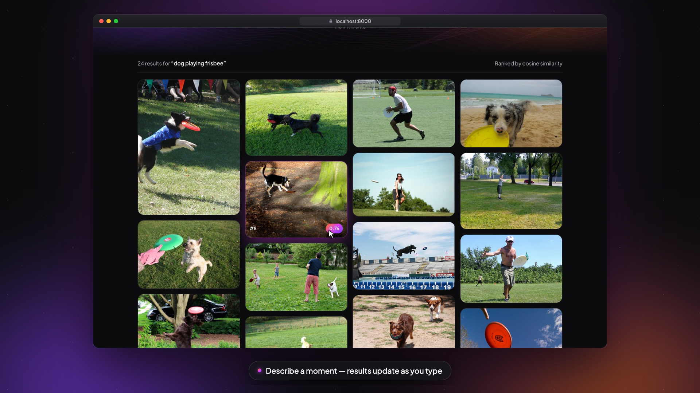

# Memora

Search your local photos by meaning ("dog on a beach at sunset", "मेरी बहन की शादी") using
[EmbeddingGemma 2](https://huggingface.co/google/embeddinggemma-2). Everything runs locally.

**Stack:** FastAPI + Jinja2 (server-rendered) + HTMX · SQLite + numpy for vectors · sentence-transformers.

## ▶ Watch how it works

[](https://drive.google.com/file/d/1_0xsjTRdx0fb3K1t4V2As_ESU6H-S3Qy/view?usp=sharing)

**[Watch the 76-second explainer on Google Drive](https://drive.google.com/file/d/1_0xsjTRdx0fb3K1t4V2As_ESU6H-S3Qy/view?usp=sharing)**: indexing, the shared text and image vector space, cosine ranking, the live app (with a Hindi query), and the stack.

## Setup

```bash
uv sync                    # install deps
cp .env.example .env       # set GG_PHOTOS_DIR
uv run python -m app.indexer               # embed photos (downloads model on first run, ~1.5 GB)
uv run uvicorn app.main:app --reload       # http://127.0.0.1:8000
uv run pytest                              # tests use a fake embedder, no model needed
```

## Layout

```
app/
  main.py       routes: /, /search (HTMX partial), /photo/{id}
  config.py     settings from .env (GG_ prefix)
  embedder.py   EmbeddingGemma 2 wrapper (text + vision encoders only)
  store.py      SQLite store + cosine search
  indexer.py    incremental indexer (new / changed / deleted files)
  templates/    Jinja2 pages
  static/       CSS
tests/
```

## Next ideas
- Thumbnails cache (serving full-size images is slow for big libraries)
- "More like this" — search by photo embedding
- Video support (`<|video|>` inputs), sqlite-vec for large libraries
